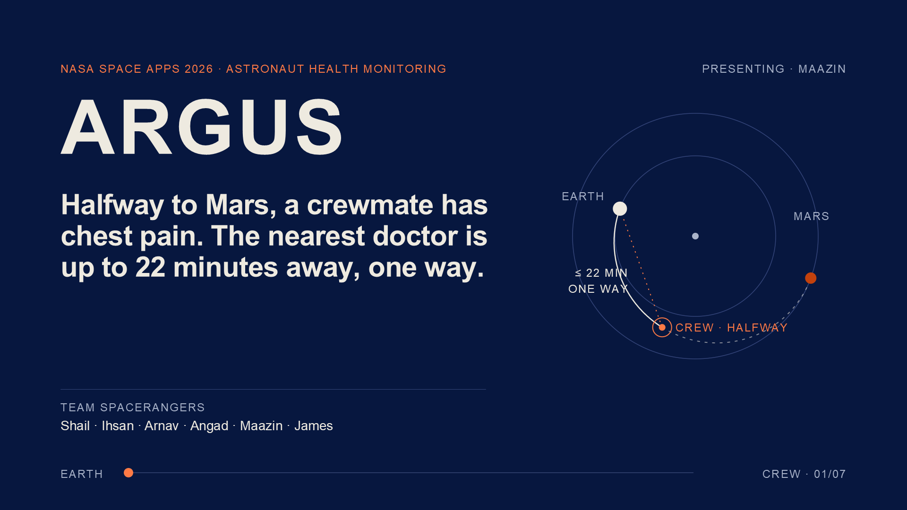
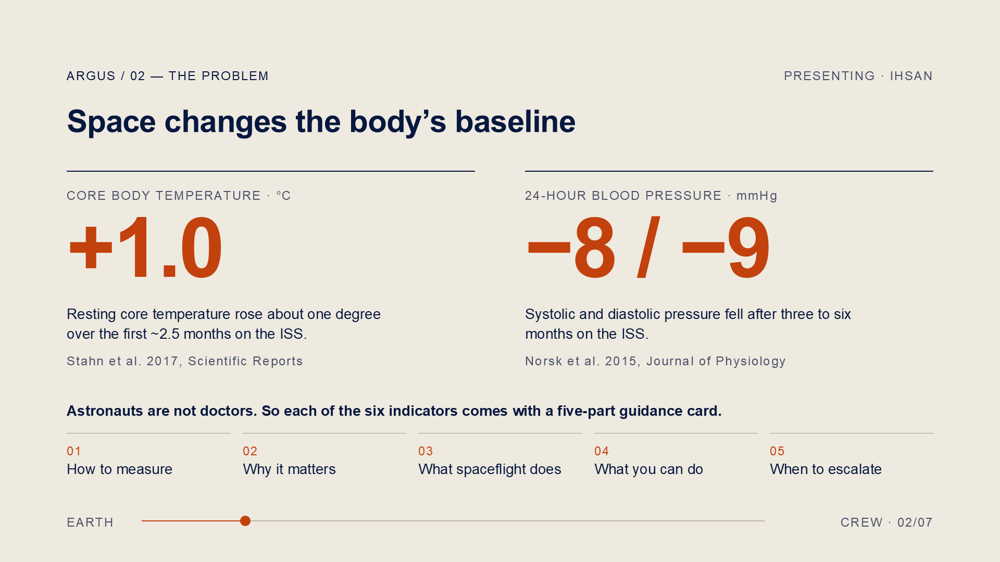
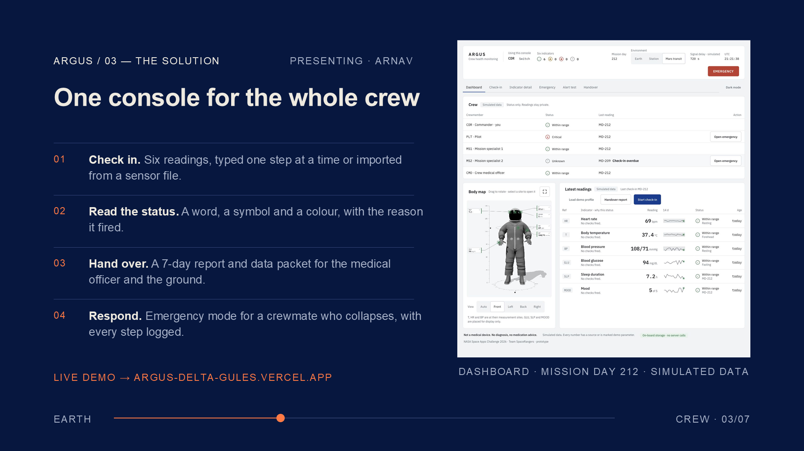
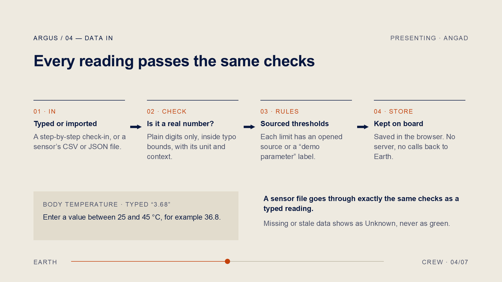
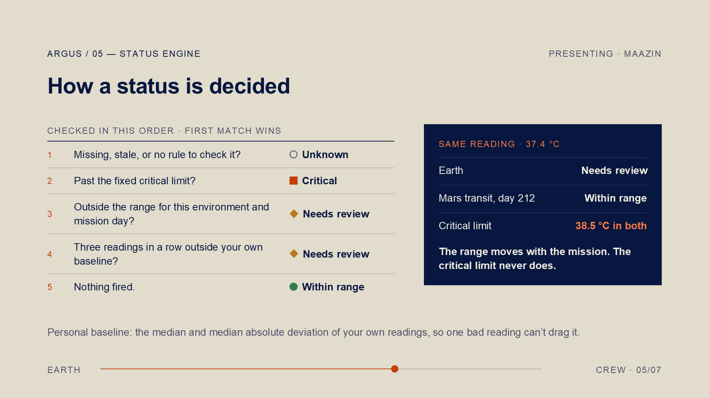
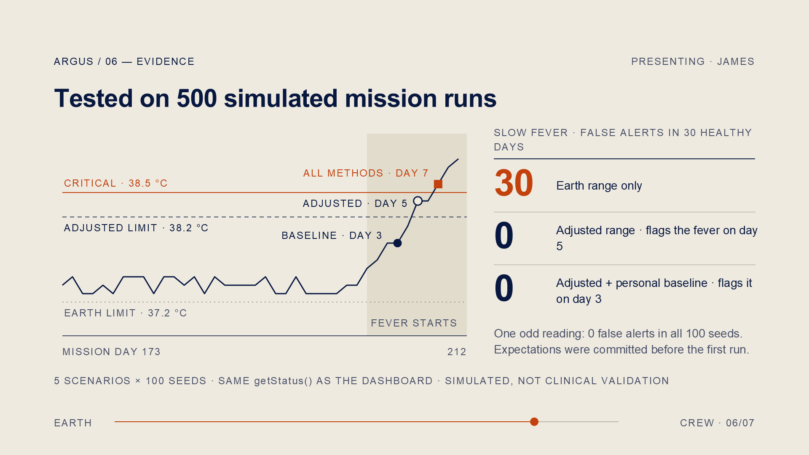
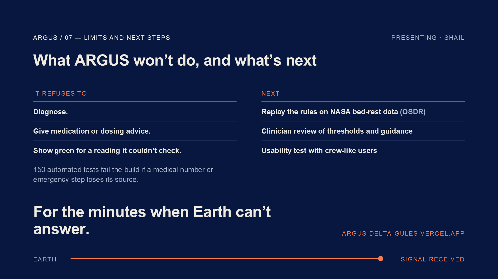

# ARGUS — NASA Space Apps Challenge 2026 Pitch

- **Live Console:** https://argus-delta-gules.vercel.app
- **View / Download PDF:** [ARGUS — Space Apps 2026 Pitch.pdf](./ARGUS%20%E2%80%94%20Space%20Apps%202026%20Pitch.pdf)
- **Download Editable Deck (`.pptx`):** [ARGUS — Space Apps 2026 Pitch.pptx](./ARGUS%20%E2%80%94%20Space%20Apps%202026%20Pitch.pptx)

---

### Slide 1 — Title & Delay Gap (Maazin)

### Slide 2 — Spaceflight Physiology & Guidance (Ihsan)

### Slide 3 — Shared Crew Console & Demo (Arnav / Maazin)

### Slide 4 — Inputs, Validation & Local Storage (Angad)

### Slide 5 — Ordered Rule Engine (Maazin)

### Slide 6 — Pre-Registered Simulation Benchmark (James)

### Slide 7 — Limits & Next Steps (Shail)

