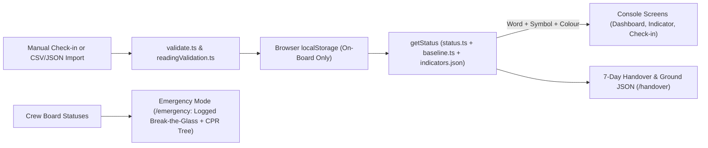

# ARGUS — Autonomous Crew Medical Console

**NASA Space Apps Challenge 2026 · Team SpaceRangers · License: Apache 2.0**

> *ARGUS is a hackathon software prototype evaluated on simulated data. It is not a medical device and has not been clinically validated.*

### Quick Links

| Resource | Link |
| --- | --- |
| **Live Web Console (Zero Server Calls)** | https://argus-delta-gules.vercel.app |
| **Final Pitch Slide Deck (PDF — View in Browser)** | [ARGUS — Space Apps 2026 Pitch.pdf](https://github.com/Maazin2007/ARGUS/blob/presentation/presentations/ARGUS%20%E2%80%94%20Space%20Apps%202026%20Pitch.pdf) |
| **Final Pitch Slide Deck (Editable `.pptx`)** | [Download ARGUS — Space Apps 2026 Pitch.pptx](https://github.com/Maazin2007/ARGUS/raw/presentation/presentations/ARGUS%20%E2%80%94%20Space%20Apps%202026%20Pitch.pptx) |
| **GitHub Repository (`main`)** | https://github.com/Maazin2007/ARGUS |
| **Evaluation Protocol & Full Results** | [plan/EVALUATION.md](https://github.com/Maazin2007/ARGUS/blob/main/plan/EVALUATION.md) · [results/summary.md](https://github.com/Maazin2007/ARGUS/blob/main/results/summary.md) · [results/sensitivity.md](https://github.com/Maazin2007/ARGUS/blob/main/results/sensitivity.md) |

---

## 1. High-Level Summary

> **On the way to Mars, the doctor is minutes away in each direction. ARGUS is for that gap.**

ARGUS is an on-board browser application that helps astronauts assess their own health when Earth is too far away to ask in real time. Crewmembers log six indicators—by hand or via browser CSV/JSON sensor import—and receive a plain-language status, explanation, and five-section reference card for each. Reference ranges shift with the spaceflight environment and mission day (`Stahn et al. 2017` for core temperature; `Norsk et al. 2015` for blood pressure), an outlier-resistant personal baseline flags sustained changes across three consecutive readings, a 7-day handover report packages alerts for the Crew Medical Officer and Mission Control, and a red emergency mode walks a responder through a collapse with logged break-the-glass vitals access. We tested the status engine across five scenarios and 100 random seeds per scenario plus a pre-registered 2,000-run sensitivity grid, publishing both average and worst-case performance.

---

## 2. The Problem & Mission Context

1. **Communication delay eliminates live Earth triage:** The published microgravity CPR guideline (`Hinkelbein et al. 2020`) cites a one-way Mars communication delay of **3 to 23 minutes**. Calling Mission Control and waiting for a flight surgeon to reply can take nearly three-quarters of an hour.
2. **Astronauts are not physicians:** In a non-medical crew, a vital reading alone (`37.4 °C`, `108/71 mmHg`) does not tell the crewmember how to measure accurately, why spaceflight alters it, what self-care applies, or when to escalate.
3. **Earth reference ranges cry wolf in flight:** Microgravity alters resting astronaut physiology—core body temperature rises (`+1.01 °C` over 75 flight days, `Stahn et al. 2017`) while ambulatory blood pressure falls (`−8 mmHg` systolic / `−9 mmHg` diastolic over 85 flight days, `Norsk et al. 2015`). Static Earth bounds flag healthy flight readings daily, driving alarm fatigue.
4. **Why deterministic rules instead of opaque ML or cloud servers:** Data from a few dozen astronauts is too small for reliable black-box clinical prediction, and an isolated crew needs an auditable reason behind every alert with zero external server dependency.

---

## 3. Solution Overview & Capabilities

### Core Workflows

- **Shared Crew Console (`/`):** One ship-board browser console. Each crewmember taps their own profile (MS1, Pilot, MS2, CMO) to view their own history, sparklines, and status badges. Crewmates only see a status word (`Within range`, `Needs review`, `Critical`, `Unknown`) and last reading day—surfacing critical states or missed check-ins without exposing private numbers. *(No browser password is used because client-side JS cannot keep secrets from DevTools; privacy rests on minimal exposure and logged break-the-glass access.)*
- **Six Health Indicators & Device Import (`/check-in`):** Tracks Heart Rate (`bpm`), Body Temperature (`°C`), Blood Pressure (`mmHg`), Blood Glucose (`mg/dL`), Sleep Duration (`h`), and Mood (`1–5`), either via step-by-step manual entry or browser-side CSV/JSON sensor packet parsing (`src/lib/deviceImport.ts`) with reading provenance (`Typed in check-in`, `Device import`, `Demo profile`).
- **Four Accessible Statuses:** `Within range` (`✓` Green), `Needs review` (`▲` Amber), `Critical` (`■` Red), and `Unknown` (`?` Grey)—always rendered together as **word + symbol + colour**. Any missing, invalid, malformed, or stale (`> 48 hours`) input becomes `Unknown`, never `Green`.
- **Five-Section Indicator Cards (`/indicator/[id]`):** Interactive SVG strip chart showing Earth range, space-adjusted range, and 14-day personal baseline bands beside a structured reference card (*How to measure*, *Why it matters*, *What spaceflight does*, *What you can do*, *When to escalate*).
- **Feel vs. Data & Combined Checks:** Flags disagreements between objective vitals and self-reported status (e.g., rating `4–5` while indicators need review, or rating `1–2` while all vitals are green) and combined patterns such as short sleep paired with low mood.
- **7-Day Handover Report (`/handover`):** Packages mission day, simulated light delay, flagged indicators, and check-in history into a printable summary and copyable JSON telemetry bundle for the Crew Medical Officer and ground flight surgeon.
- **Red Emergency Mode (`/emergency`):** Triggered from any crew row or header pill on a chest-pain collapse scenario. Asks who is responding, shows rescue vitals first with one-tap **logged break-the-glass** full-record access, walks `Y/N` keyboard-accessible checks with a live UTC step log, displays an elapsed timer, provides microgravity CPR methods anchored to `Hinkelbein et al. 2020` (`Evetts-Russomano`, `Reverse-Bear-Hug`, `Handstand on CMRS`, electrical isolation), and builds a copyable ground emergency packet without falsely claiming live transmission.

### Ordered Rule Engine (`src/lib/status.ts`)

1. **Input & Freshness Gate:** Validate numeric sanity bounds and check staleness (`> 48 h` → `Unknown`, never `Green`).
2. **Fixed Critical Limits:** Check hard upper/lower critical ceilings (`38.5 °C` fever, `40 bpm` bradycardia, `180/120 mmHg` hypertensive crisis, `< 54` or `> 250 mg/dL` glucose) → `Critical`. **Nothing ever shifts a critical limit.**
3. **Environment & Mission-Day Reference Adjustment:** Shift normal bounds linearly over mission days toward published ISS shifts (`+1.01 °C` temp upper bound over 75 days → `38.21 °C`; `−8/−9 mmHg` BP over 85 days) when in `station` or `marsTransit` → `Needs review` if outside.
4. **Outlier-Resistant Personal Baseline (`src/lib/baseline.ts`):** Compute rolling 14-day `Median ± max(floor, 3 × MAD)` across 5–10 prior non-outlier readings so a single typo/outlier cannot corrupt the baseline, and require **3 consecutive deviations** to trigger `Needs review`.

---

## 4. Architecture & Data Flow

ARGUS runs **100% client-side** in Next.js, React, and TypeScript (`localStorage`, zero backend server, zero database, zero outbound telemetry requests), styled with CSS tokens and Tailwind, with a `Three.js` 6-site body figure (and automatic 2D wireframe canvas fallback). Pure rule modules in `src/lib/` and threshold/copy JSONs in `src/data/` are guarded by **150 automated tests** (`tests/`) enforcing input validation, status determinism, colour-token consistency, and source provenance labels.

### Routes

| Screen | Route | Purpose |
| --- | --- | --- |
| Dashboard | `/` | Crew board selector, 6 indicators, 14-day sparklines, interactive 3D/wireframe body map, Earth / Station / Mars environment toggle |
| Check-in & Device Import | `/check-in` | Step-by-step measurement entry, measurement help, sample/custom CSV & JSON device import, feel-vs-data check |
| Indicator Detail | `/indicator/[id]` | SVG strip chart with Earth, adjusted, and personal baseline bands plus 5-section reference card |
| Handover Report | `/handover` | 7-day Crew Medical Officer summary and ground telemetry JSON packet |
| Emergency | `/emergency` | Role selection, rescue vitals, logged full-record unlock, Y/N triage tree, microgravity CPR steps, ground message builder |
| Alert Benchmark | `/alerts` | Interactive 5-scenario simulator and 100-seed trace viewer powered by the live `getStatus` engine |

---

## 5. Alert Evaluation & Pre-Registered Benchmark (`npm run evaluate`)

All benchmarks run the exact same `getStatus` function used by the live UI across five simulated scenarios (`100` consecutive seeds each, generated deterministically with `mulberry32`) plus a pre-registered `2,000`-run sensitivity grid (`results/summary.md`, `results/fever.md`, `results/sensitivity.md`, `plan/EVALUATION.md`).

### Five-Scenario Headline Results (Frozen Seed & 100 Seeds: Mean / Worst)

| Scenario | Method | First amber | First red | Missed | False alerts | 100-seed first amber (mean / worst) | 100-seed false amber (mean / worst) |
| --- | --- | --- | --- | --- | --- | --- | --- |
| **Slow-onset fever** *(30d @ `37.4±0.1 °C`, then `+0.15 °C/d`)* | Earth range only | Day 0 | Day 7 | 0 | **30** | `0 / 0` | `30 / 30` |
| **Slow-onset fever** | Adjusted range | Day 5 | Day 7 | 5 | **0** | `5.3 / 6` | `0 / 0` |
| **Slow-onset fever** | **Adjusted range + baseline** | **Day 3** | **Day 7** | **3** | **0** | **`3.84 / 5`** | **`0 / 0`** |
| **Single odd reading** *(one `+0.5 °C` glitch)* | Earth range only | none | none | 0 | **40** | none | `40 / 40` |
| **Single odd reading** | Adjusted range | none | none | 0 | **0** | none | `0 / 0` |
| **Single odd reading** | **Adjusted range + baseline** | **none** | **none** | **0** | **0** | **none** | **`0 / 0`** |
| **Sudden spike** *(`+1.6 °C` on onset day)* | Earth / Adjusted / Both | none | Day 0 | 0 | 30 / 0 / 0 | none | `30 / 30` (Earth), `0 / 0` |
| **Creeping sleep debt** *(`7.6 h`, `−0.15 h/night`)* | All three methods | Day 5 | none | 5 | 0 | `3.78 / 5` | `0 / 0` |
| **Falling mood** *(`4`, `−0.25/day`)* | All three methods | Day 5 | none | 5 | 0 | `5.27 / 7` | `0 / 0` |

### Pre-Registration Audit Trail & Sensitivity Grid (2,000 Runs)

To prove predictions were not tuned after seeing outcomes, key files were committed in Git before the code that tested them (`plan/EVALUATION.md`, Section 5):

| Commit (15 Nov 2026 CST) | Hash | Verified Order |
| --- | --- | --- |
| Temperature adjustment fix (moves upper bound only) | `d2e484c` | Fix predated alert benchmark |
| `scripts/scenarios/fever.json` + 4 expectations + `0.3 °C` baseline floor | `10e27ba` | Scenario & predictions committed before `scripts/evaluate.ts` |
| `scripts/evaluate.ts` & frozen fever results | `81983c1` | Results generated after predictions (`fever.json` results unchanged since) |
| Remaining 4 scenarios (`typo`, `spike`, `sleepDebt`, `moodDrop`) + results | `5497197` | Expectations written before first run, committed together (reported transparently, not claimed pre-registered) |
| `scripts/scenarios/sensitivity.json` (20-point grid & 7 predictions `P1–P7`) | `6c665d2` | Grid & predictions committed before sensitivity runner code |
| Sensitivity runner code & `results/sensitivity.*` (2,000 runs) | `68e5869` | Predictions `P1–P7` evaluated automatically with zero edits to `sensitivity.json` |

**Sensitivity Verdict (`5 of 7` predictions met, `plan/EVALUATION.md` Section 8):**
- **What held (`P1, P2, P3, P4, P7`):** Across all 20 settings (`noise 0.05–0.3 °C × rise 0.05–0.3 °C/day`), the adjusted range produced `0` false alerts (`P1`), adjusted + baseline averaged `0` false alerts up to noise `0.2` and `0.03` at noise `0.3` (`P2`), baseline was never slower than range alone (`P4`), and the critical red day never shifted (`P7`).
- **What failed (`P5, P6`) — published openly as our weak spot:** Very slow fevers (`+0.05 °C/day`, totaling `+0.5 °C` over 10 days) never reach the `38.21 °C` ceiling, and the baseline caught them in `100/100` seeds at noise `0.05` but only `33/100` at noise `0.1` and `22/100` at `0.2–0.3` (below our >50% prediction `P5`). `P6` missed at `0.3 °C/day` (`0.13` days lead vs `0`).

---

## 6. Space Agency Resources & Full Provenance (`plan/SOURCES.md`)

Every medical threshold, adjustment, card, and emergency instruction traces either to an opened source below (tested automatically by `tests/`) or to an explicit `"demo parameter"` / `"Demo copy"` label.

### Published Sources

| Source | Used For |
| --- | --- |
| **NASA Space Apps 2026 Challenge Page & Video** | Mission scope & chest-pain collapse emergency scenario |
| **NASA Human Research Program: 5 Hazards & Risks of Human Spaceflight** ([nasa.gov/hrp/risks](https://www.nasa.gov/hrp/risks/)) | "What spaceflight does" guidance across indicators |
| **NASA Human Research Roadmap: Risk of Orthostatic Intolerance** | Fluid and electrolyte countermeasure guidance |
| **NASA HRP: Altered Nutrition / Sleep Loss / Behavioral Conditions** | Microgravity metabolic, circadian, and confinement context |
| **Stahn et al. (2017)**, *Scientific Reports*, [doi:10.1038/s41598-017-15560-w](https://doi.org/10.1038/s41598-017-15560-w) | Core body temperature shift (`+1.01 °C` over 75 mission days) |
| **Norsk et al. (2015)**, *Journal of Physiology*, [doi:10.1113/jphysiol.2014.284869](https://doi.org/10.1113/jphysiol.2014.284869) | 24-h ambulatory blood pressure shift (`−8 mmHg` systolic / `−9 mmHg` diastolic, days 85–192 in 8 ISS astronauts) |
| **Hinkelbein et al. (2020)**, *Scand J Trauma Resusc Emerg Med*, [doi:10.1186/s13049-020-00793-y](https://doi.org/10.1186/s13049-020-00793-y) | Microgravity CPR guideline (`Published` Step `a3`: Evetts-Russomano, Reverse-Bear-Hug, Handstand on CMRS, defibrillator electrical isolation) |
| **Institute of Medicine (2001)**, *Safe Passage*, Ch. 1 & 6 | Autonomous exploration care & longitudinal baseline monitoring rationale |
| **American Heart Association (AHA)** | Resting HR (`60–100 bpm`), upper normal BP (`119/79 mmHg`), hypertensive crisis critical limits (`> 180 / > 120 mmHg`) |
| **NIDDK & ADA Standards of Care** | Fingerstick glucose fasting (`≤ 99 mg/dL`) & post-load (`≤ 139 mg/dL`), Level-1 alert (`< 70 mg/dL`), Level-2 critical (`< 54 mg/dL`) |
| **CDC (`About Sleep`) & MedlinePlus** | Adult sleep minimum (`≥ 7 h / 24 h`) and resting temperature measurement guidance |

### Explicitly Labelled Demo Parameters

| Parameter | Chosen Value | Purpose |
| --- | --- | --- |
| Simulated signal delays (`environments.json`) | `0 s` (Earth), `1 s` (Station), `720 s` (Mars transit) | Demonstrates light-time latency gap |
| Earth resting temperature demo interval | `36.0–37.2 °C` | Illustrative resting band paired with `37.4 ± 0.1 °C` ISS/transit base |
| Resting BP lower bounds & HR/Temp/Glucose floors | `90/60 mmHg`; baselines `10 bpm`, `0.3 °C`, `6/5 mmHg` | Minimum deviation floors preventing hypersensitive noise alarms |
| Personal baseline parameters | `14-day` window, `5–10` readings, `3 × MAD`, `3` consecutive deviations | Outlier-resistant drift detection |
| Critical thresholds without single fixed citation | HR `< 40 bpm`, Temp `≥ 38.5 °C`, Glucose `> 250 mg/dL`, Short sleep `< 4 h × 2` | Fixed safety ceilings (never shift with environment) |
| Input sanity bounds (`validate.ts`) | HR `20–250`, Sys `40–300`, Dia `20–200`, Glu `20–600`, Temp `25–45 °C`, Sleep `0–24 h`, Mood `1–5` | Typo rejection, not medical bounds |
| Stale threshold | `48 hours` | Prevents old readings from reading `Green` (`Unknown` instead) |

---

## 7. Hard Safety Boundaries, Limitations & Next Steps

### What ARGUS Refuses to Do
- **No diagnosis:** Explains which limit or personal baseline rule fired; never names an illness or medical condition.
- **No medication or dosing advice:** Never suggests drugs, dosages, or prescriptions.
- **Unknown is never Green:** Missing, corrupted, uncheckable, or stale (`> 48 h`) data returns `Unknown`.
- **CPR rate/depth omitted deliberately:** `Hinkelbein et al. 2020` states rate and depth follow Earth AHA/ERC training rather than setting microgravity-specific numbers, and explicitly notes CPR has never been performed on a human in spaceflight.

### Explicit Prototype Limitations
- All crew profiles, telemetry histories, and alert scenarios are **simulated**; zero clinical validation has been conducted.
- Only temperature and blood pressure adjust for spaceflight; sleep and mood carry no adjustment or personal baseline in current rules.
- `tests/` verify software determinism, boundary checks, and source/label presence—not clinical appropriateness of thresholds.
- Unsourced triage questions (`s1`, `a1`, etc.) are explicitly tagged `Demo copy`.

### Next Steps
1. **Replay on Real NASA Bed-Rest Data:** Run `getStatus` unchanged against the **UTMB head-down bed-rest dataset** on NASA Life Sciences / OSDR (`DOI 10.83263/wjw1-ta27`) with injected events to measure real-world human false-alarm vs. detection latency.
2. **Pre-Register Slow-Fever & Warning Metrics:** Add a "first warning (amber or red)" benchmark metric and address gradual `0.05 °C/day` rises without relaxing noise immunity.
3. **Ephemeris-Driven Light-Time Table:** Replace the fixed `720 s` demo parameter with mission-day JPL Horizons Earth–Mars one-way delay lookup.
4. **Passive Cabin / Dosimeter Streams & Objective Cognitive Checks:** Feed MSL RAD / OSDR RadLab and cabin $\text{CO}_2$ / $\text{SpO}_2$ packets into `deviceImport.ts` and pair subjective mood with a 3-minute Psychomotor Vigilance Test (PVT-B).
5. **Clinician Review & Crew-Like Usability Testing:** Conduct formal flight-surgeon threshold review and timed task trials under simulated latency stress.

---

## 8. Use of AI Disclosure (`plan/AI_USE.md`)

| Date | Member | Tool | Scope of Use |
| --- | --- | --- | --- |
| 14 Nov 2026 | Maazin | Claude Code | Next.js app scaffolding, build plan review, `plan/` documentation, `README.md`, CI workflow, `src/lib/types.ts`, initial `getStatus` stub and first test |
| 14 Nov 2026 | Maazin | Gemini (Antigravity) | Step-by-step tutoring and unit tests (`tests/baseline.test.ts`, `tests/status.test.ts`) for `median`, `spread`, `checkReading`, and `adjustRange` |
| 14 Nov 2026 | James | Claude Code | `src/lib/feelVsData.ts`, `tests/feelVsData.test.ts`, `scripts/generate.ts` (`mulberry32` seeded simulation), `scripts/profiles/demo.json`, `src/data/seed.json` generation and unit tests |
| 14 Nov 2026 | Ihsan | Antigravity | Drafting and structuring all 6 indicator reference cards (`src/data/cards.json`), verifying NASA/AHA/CDC/NIDDK citations in `plan/SOURCES.md` |
| 14 Nov 2026 | Angad | ChatGPT | Guidance and review on `storage.ts`, `validate.ts`, `data.test.ts`, and literature applicability checks |
| 14 Nov 2026 | Arnav | Claude Code & Claude | Porting ARGUS design mockup into Next.js screens (`Three.js` 3D suit + wireframe fallback), storage error handling, colour token parity tests, `emergency.json` source tests, 5-scenario 100-seed evaluator, CSV/JSON device import, `/handover`, and accessibility fixes |
| 15 Nov 2026 | Shail | Antigravity & Codex | Final pitch preparation (`ARGUS — Space Apps 2026 Pitch`), Space Apps submission evidence extraction, demo video synthesis (`brag-output`), and full project wiki page compilation |
